# SaaS Admin

SaaS Admin is the operator console and application registry for an internal app platform. It records which applications are published, which deployments have been reviewed, and where Portal can route application traffic.

English · [简体中文](README.zh-CN.md)

Consider a monthly reporting app. An operator registers **Reports** in Admin, verifies its deployment and publishes it at `/reports`. Employees find it in **Portal**, the app directory, and sign in through **Keycloak**. **SaaS Auth** decides which employees can open Reports and which roles they have. Portal uses Admin’s private API to look up the current deployment before forwarding a business request.

| If you want to… | Start here |
| --- | --- |
| Run the Admin API or console locally | [Local setup](#local-setup) |
| Onboard, replace or revoke an application deployment | [Publish an app](#publish-an-app) |
| Integrate Portal or investigate visibility and access | [Architecture](#architecture) · [API reference](#api-reference) |
| Change the service or deploy it | [Database](#database) · [Source map](#source-map) · [Development and deployment](#development-and-deployment) |

## Architecture



- **The Admin console** is a separate Next.js service with English and Chinese interfaces. Operators sign in through Keycloak. The console checks their stable Keycloak subject against an allowlist and uses its own database account for catalog writes and sessions. It forwards grant changes and access-request reviews to Auth’s operator API.
- **The private Admin API** is a Fastify service for Portal’s server. It reads publications and deployment metadata from Admin’s PostgreSQL database. The service key authenticates Portal. For user-scoped reads, Admin forwards the bearer token to Auth, which validates it. Admin treats the token as opaque.
- **Portal** serves the app directory and proxies requests to reviewed deployment origins. It checks access when an employee opens an app and independently checks the origin against its infrastructure policy.
- **SaaS Auth** owns platform user IDs, role definitions, grants and access requests. A global Admin publication makes an app eligible for discovery. An employee still needs an Auth grant with at least one role to use it.

## Local setup

Run these commands from this repository with Node.js 24.10+ and a PostgreSQL 17 database dedicated to Admin. Have a SaaS Auth endpoint available for user-scoped requests. With the sibling saas-auth repository’s local Compose setup, Auth is at `http://127.0.0.1:58000`.

```sh
npm ci
cp -n .env.example .env.local
node -e 'console.log(require("node:crypto").randomBytes(32).toString("base64url"))'
```

Set `ADMIN_DATABASE_URL` and `ADMIN_AUTH_URL` in `.env.local` and put the generated credential in `ADMIN_PORTAL_KEY`. Share that key with the Portal server as `PORTAL_ADMIN_KEY`. The example’s HTTP setting is for loopback development. Use HTTPS for remote services.

```sh
node --env-file=.env.local src/cli.ts migrate
node --env-file=.env.local src/server.ts
```

In another terminal, run `curl --fail http://127.0.0.1:59100/health/ready`. Expect `{"status":"ready"}` once the API can read its database tables. User-scoped endpoints also need a working Auth service.

### Run the operator console

Configure a confidential Keycloak client with authorization code flow and PKCE. For local development, set the console origin to `http://127.0.0.1:3003` and register that origin’s `/api/auth/callback` as its redirect URI. Copy [web/.env.example](web/.env.example) to `web/.env.local`. Set the operator database connection, OIDC settings, the subject allowlist, a stable 32-byte base64 session key, and Auth’s private operator credentials. Set `ADMIN_UI_ALLOW_LOCAL_HTTP=true` for HTTP on loopback.

```sh
npm ci --prefix web
npm run dev --prefix web -- --port 3003
```

Open [the English console](http://127.0.0.1:3003/en/applications) or [the Chinese console](http://127.0.0.1:3003/zh/applications). See the [console guide](docs/ADMIN-CONSOLE.md) for Keycloak client settings and [the integration harness](integration/console.py) for a disposable PostgreSQL and Keycloak test environment.

## Publish an app



1. In **Applications**, create an active app with a stable UUID and a unique mount such as `/reports`. Use that UUID when configuring access in Auth.
2. In **Deployments**, register a new runtime deployment. Use the digest of the deployed artifact, a reviewed origin, and runtime `http` or `nextjs`. For Next.js, assign a fresh immutable asset version.
3. Verify the deployment outside Admin, then mark it **Ready**. Approval records the operator’s attestation.
4. In **Publications**, select the ready deployment and set `enabled`, `entitled` and `validUntil`. Admin evaluates the expiry against database time.
5. Define the app’s roles in Auth, then grant them directly or approve an employee’s access request. In the console, use the application’s access controls and the **Requests** workspace. See the [access workflow](docs/APP-ACCESS-REQUESTS.md).

### Automate catalog writes

Use an operator database connection, set `ADMIN_ENABLE_OPERATOR=true` and supply an audit actor. Each JSON file holds one operation from the [operator schema](contracts/operator.schema.json). A new write takes a fresh 16–128 character key. To retry, reuse the original key, actor and operation. Admin commits the audit record and mutation together.

```sh
OPERATION_KEY=$(uuidgen)
ADMIN_ENABLE_OPERATOR=true ADMIN_OPERATOR_ID=operator:alice \
  node --env-file=.env.local src/cli.ts apply publish.json "$OPERATION_KEY"
```

Example `publish.json` for an existing app and approved deployment. Substitute their IDs and the intended expiry.

```json
{
  "kind": "publication",
  "appId": "00000000-0000-4000-8000-000000000001",
  "deploymentId": "00000000-0000-4000-8000-000000000002",
  "enabled": true,
  "entitled": true,
  "validUntil": "2027-01-01T00:00:00Z"
}
```

For onboarding, apply `app`, `runtime-deployment`, `deployment-status` with `ready`, and `publication` in that order. Configure `ADMIN_APP_DNS_SUFFIXES` or `ADMIN_ALLOWED_APP_ORIGINS` on the operator process. Portal enforces its own origin policy when routing traffic.

### Replace, unpublish or revoke

- **Replace a release.** Register and approve a new deployment of the same app, then run `replace-deployment` with a future `assetsUntil`. The publication switches to the new deployment and the old deployment becomes `retired` in one transaction. Keep the old Next.js origin and immutable assets available until the deadline.
- **Unpublish an app.** Set `enabled=false` or `entitled=false`, or let the publication expire. That removes discovery and business-route eligibility. Public build assets follow their own version eligibility.
- **Revoke a deployment.** Set its status to `revoked` to remove both business routing and public asset lookup on subsequent reads. Use a new deployment ID for a later release.

Normal changes within the existing egress policy take effect without restarting Portal in Admin registry mode. See the [runtime registry guide](docs/RUNTIME-REGISTRY.md) for release compatibility and asset serving.

## API reference

All routes below use `GET`. The private `/v1` routes require `X-Portal-Key`. Routes marked **Bearer** also require an employee’s delegated `Authorization: Bearer …` token. Keep service credentials and resolved origins on the server.

| Route | Bearer | Purpose |
| --- | --- | --- |
| `/health/ready` | — | Check that Admin can query the required PostgreSQL tables. No service key is needed. |
| `/v1/discovery?cursor=…` | Yes | List published, eligible app metadata for a signed-in employee, including apps they can request access to. |
| `/v1/catalog?cursor=…` | Yes | List eligible apps for which Auth confirms access, with the employee’s roles. |
| `/v1/runtime-route?suffix=/reports` | Yes | Resolve the current reviewed deployment, origin, runtime metadata, verified user and roles. |
| `/v1/route?suffix=/reports` | Yes | Resolve a route using the legacy response shape. |
| `/v1/runtime/assets?suffix=/reports&version=BUILD` | — | Resolve a ready or temporarily retained Next.js build for immutable public asset requests. |



Discovery and catalog use UUID-ordered pages of up to 50 candidates. Keep advancing with `nextCursor` until it is `null`, even when access filtering leaves an empty catalog page. Business route resolution checks the current publication and deployment again after Auth returns, and refuses a route when the deployment changes during the lookup. All API responses use `Cache-Control: no-store`. Dependency failures fail the request.

Check `400` for invalid query parameters, `401` for missing or invalid credentials, `403` for denied access, `404` for an unavailable route or asset, and `503` for dependency failures. See the [OpenAPI contract](contracts/openapi.json).

## Database

Admin stores its catalog, runtime records, operation log and console sessions in PostgreSQL. The app UUID also identifies the app in Auth; their databases are independent.



| Table | Key | Purpose |
| --- | --- | --- |
| `app_definitions` | `id` | App identity, display metadata, unique mount and active flag |
| `deployments` | `id` | App, artifact digest, reviewer, review time and readiness |
| `app_publications` | `app_id` | Current deployment, publication flags and expiry, one record per app |
| `deployment_routes` | `deployment_id` | Reviewed origin for a deployment |
| `runtime_deployments` | `deployment_id` | Mount, runtime, asset version, status and compatibility deadline |
| `catalog_operations` | `key` | Transactional audit and idempotency record for operator mutations |
| `admin_console_sessions` | `id` | Hashed session or login transaction ID, encrypted payload and expiry |
| `admin_schema_history` | `id` | Applied migrations tracked by node-pg-migrate |

Publications and runtime records use composite foreign keys to ensure their deployment belongs to the same application. The [SQL baseline](migrations/1795360359689_initial_admin_schema.sql) defines the exact columns and constraints. On upgrade, [the migration runner](src/migrate.ts) verifies any previous checksummed history and preserves existing records. The baseline archives a remaining tenant installations table in the private `legacy_tenancy` schema.

## Source map

| Change | Entry point |
| --- | --- |
| Private HTTP routes, readiness and service-key authentication | [src/app.ts](src/app.ts) · [src/server.ts](src/server.ts) |
| Catalog, Auth lookups and route resolution | [src/service.ts](src/service.ts) |
| Operator mutations, runtime state and CLI | [src/db.ts](src/db.ts) · [src/runtime.ts](src/runtime.ts) · [src/cli.ts](src/cli.ts) |
| Console UI, sign-in and access review | [web/app/](web/app/) · [web/lib/auth.ts](web/lib/auth.ts) · [src/operator-auth.ts](src/operator-auth.ts) |
| API and operation schemas | [src/contracts.ts](src/contracts.ts) · [scripts/contracts.ts](scripts/contracts.ts) |
| Migrations, database grants and Helm | [migrations/](migrations/) · [scripts/database-grants.ts](scripts/database-grants.ts) · [deploy/](deploy/) |

## Development and deployment

```sh
npm test
npm run typecheck
npm run format:check
npm test --prefix web
npm run typecheck --prefix web
```

Run `npm run contracts` after changing an API or operator operation and review both generated contracts. Keep applied SQL migration files immutable. See [catalog integration](integration/README.md) and [console verification](docs/ADMIN-CONSOLE.md#verification) for test environments that use real PostgreSQL and Keycloak.

In Kubernetes, install infrastructure and Auth first, then deploy [the platform Helm release](deploy/README.md) with immutable image digests. The release runs Admin’s migration and grants job before rolling out the private API and the console. Use separate database accounts for migrations, the read-only API and the operator console. Serve the internal API over TLS, restrict access to Portal, and run the release smoke test after deployment.
