# SaaS Admin

SaaS Admin 是企业内部应用平台的管理控制台与应用注册表。它记录哪些应用已经发布、哪些部署已通过审核，以及 Portal 应将应用流量转发到哪里。

[English](README.md) · 简体中文

以月度报表应用为例。管理员在 **Admin** 注册报表应用，验证部署后将它发布到 `/reports`。员工在应用门户 **Portal** 找到报表，通过 **Keycloak** 登录。**SaaS Auth** 决定哪些员工有权打开报表、他们拥有哪些角色。Portal 在转发业务请求前，通过 Admin 私有 API 查询当前部署。

| 你想做什么 | 从这里开始 |
| --- | --- |
| 在本地运行 Admin API 或控制台 | [本地运行](#本地运行) |
| 接入应用、替换版本或撤销部署 | [发布应用](#发布应用) |
| 对接 Portal，或排查应用可见性和访问权限 | [架构](#架构) · [API 参考](#api-参考) |
| 修改服务或部署 | [数据库](#数据库) · [源码导航](#源码导航) · [开发与部署](#开发与部署) |

## 架构



- **Admin 控制台**是独立运行的 Next.js 服务，提供中英文界面。管理员通过 Keycloak 登录。控制台按稳定的 Keycloak subject 校验管理员白名单，并使用专用数据库账号写入目录和会话。直接授权和访问申请审批由控制台调用 Auth 的管理接口处理。
- **Admin 私有 API** 使用 Fastify，供 Portal 服务端调用。它从 Admin 的 PostgreSQL 数据库读取发布记录和部署元数据。服务密钥用于验证 Portal 身份。查询涉及员工权限时，Admin 将 Bearer 令牌原样转交给 Auth 校验。
- **Portal** 提供应用目录，并将请求代理到已审核的应用源站。员工打开应用时，Portal 检查其访问权限，并按自身的基础设施策略校验源站。
- **SaaS Auth** 管理平台用户 ID、角色定义、授权和访问申请。Admin 的全局发布记录决定应用是否具备展示资格。员工要使用应用，仍须在 Auth 获得至少一个应用角色。

## 本地运行

在本仓库执行以下命令。需要 Node.js 24.10+ 和一个专供 Admin 使用的 PostgreSQL 17 数据库。需要员工身份的接口还依赖 SaaS Auth。如果使用相邻 saas-auth 仓库的本地 Compose 环境，Auth 地址是 `http://127.0.0.1:58000`。

```sh
npm ci
cp -n .env.example .env.local
node -e 'console.log(require("node:crypto").randomBytes(32).toString("base64url"))'
```

在 `.env.local` 中设置 `ADMIN_DATABASE_URL` 和 `ADMIN_AUTH_URL`，将生成的密钥填入 `ADMIN_PORTAL_KEY`。在 Portal 服务端将同一个值配置为 `PORTAL_ADMIN_KEY`。示例的 HTTP 设置适用于本地回环地址，远程服务使用 HTTPS。

```sh
node --env-file=.env.local src/cli.ts migrate
node --env-file=.env.local src/server.ts
```

在另一个终端执行 `curl --fail http://127.0.0.1:59100/health/ready`。当 API 能查询所需数据表时，返回 `{"status":"ready"}`。需要员工身份的接口还要求 Auth 可用。

### 运行管理控制台

在 Keycloak 中配置使用授权码流程和 PKCE 的机密客户端。本地开发可将控制台源设置为 `http://127.0.0.1:3003`，并登记该地址下的 `/api/auth/callback` 为回调 URI。将 [web/.env.example](web/.env.example) 复制到 `web/.env.local`，配置管理员数据库连接、OIDC 参数、subject 白名单、由 32 个随机字节进行 Base64 编码的固定会话密钥，以及 Auth 管理接口的私有凭据。使用本地回环 HTTP 时，设置 `ADMIN_UI_ALLOW_LOCAL_HTTP=true`。

```sh
npm ci --prefix web
npm run dev --prefix web -- --port 3003
```

打开 [中文控制台](http://127.0.0.1:3003/zh/applications) 或 [英文控制台](http://127.0.0.1:3003/en/applications)。Keycloak 客户端的详细参数见 [控制台指南](docs/ADMIN-CONSOLE.md)，可独立运行的 PostgreSQL 与 Keycloak 测试环境见 [集成脚本](integration/console.py)。

## 发布应用



1. 在 **应用** 中创建启用的应用，分配稳定的 UUID 和唯一挂载路径，例如 `/reports`。在 Auth 配置权限时使用同一个 UUID。
2. 在 **部署** 中登记新部署，填写已部署制品的摘要、经过审核的源站和运行时类型 `http` 或 `nextjs`。Next.js 部署还需要一个全新、不可变的静态资源版本。
3. 在 Admin 外验证实际部署，再将部署标记为 **就绪**。这一步记录管理员的审核结果。
4. 在 **发布** 中选择已就绪的部署，设置 `enabled`、`entitled` 和 `validUntil`。Admin 按数据库时间判断发布是否过期。
5. 在 Auth 中为应用定义角色，再直接授权或审批员工的访问申请。控制台中的应用访问管理和 **访问申请** 工作区提供相应入口。详见 [访问申请流程](docs/APP-ACCESS-REQUESTS.md)。

### 通过 CLI 写入目录

使用具有写权限的管理员数据库连接，设置 `ADMIN_ENABLE_OPERATOR=true` 并提供审计操作者标识。每个 JSON 文件包含一条符合 [操作契约](contracts/operator.schema.json) 的操作。新操作使用 16–128 个字符的新幂等键。重试时复用原有幂等键、操作者标识和操作内容。目录变更与审计记录在同一事务中提交。

```sh
OPERATION_KEY=$(uuidgen)
ADMIN_ENABLE_OPERATOR=true ADMIN_OPERATOR_ID=operator:alice \
  node --env-file=.env.local src/cli.ts apply publish.json "$OPERATION_KEY"
```

下面的 `publish.json` 适用于已有应用和已审核部署。请替换两个 ID 和有效期。

```json
{
  "kind": "publication",
  "appId": "00000000-0000-4000-8000-000000000001",
  "deploymentId": "00000000-0000-4000-8000-000000000002",
  "enabled": true,
  "entitled": true,
  "validUntil": "2027-01-01T00:00:00Z"
}
```

通过 CLI 接入应用时，依次应用 `app`、`runtime-deployment`、状态设为 `ready` 的 `deployment-status`，以及 `publication`。在写入进程上配置 `ADMIN_APP_DNS_SUFFIXES` 或 `ADMIN_ALLOWED_APP_ORIGINS`。Portal 转发流量时会独立校验源站。

### 换版、下架与撤销

- **替换版本。** 为同一应用登记并批准新部署，再提交 `replace-deployment`，将 `assetsUntil` 设为未来时间。发布切换到新部署、旧部署进入 `retired` 状态，这两步在同一事务中完成。在兼容期限内保留旧 Next.js 源站和对应版本的静态资源。
- **下架应用。** 将 `enabled` 或 `entitled` 设为 `false`，或者让发布到期。该应用将失去目录展示和业务路由资格。公开构建资源按各自版本的可用条件处理。
- **撤销部署。** 将部署设为 `revoked` 后，后续查询将无法解析该部署的业务路由和公开静态资源。后续发版需要新的部署 ID。

在 Admin 注册表模式下，现有出口策略范围内的常规变更无需重启 Portal。兼容窗口与静态资源规则见 [运行时注册表指南](docs/RUNTIME-REGISTRY.md)。

## API 参考

下列接口均使用 `GET`。`/v1` 私有接口要求 `X-Portal-Key`。表中标为“需要”的接口，还要带上代表员工的 `Authorization: Bearer …` 令牌。服务密钥和解析得到的源站地址只在服务端使用。

| 路径 | 员工令牌 | 用途 |
| --- | --- | --- |
| `/health/ready` | 无需 | 检查 Admin 能否查询 PostgreSQL 中的必要数据表。无需服务密钥。 |
| `/v1/discovery?cursor=…` | 需要 | 为已登录员工列出符合发布条件的应用元数据，包括可申请访问的应用。 |
| `/v1/catalog?cursor=…` | 需要 | 列出员工已获准访问、且符合发布条件的应用及其角色。 |
| `/v1/runtime-route?suffix=/reports` | 需要 | 解析当前审核通过的部署、源站、运行时元数据、已验证用户及其角色。 |
| `/v1/route?suffix=/reports` | 需要 | 按旧版响应结构解析路由。 |
| `/v1/runtime/assets?suffix=/reports&version=BUILD` | 无需 | 为公开的不可变静态资源请求解析已就绪或尚在兼容期内的 Next.js 构建。 |



应用发现和目录接口按 UUID 分页，每页最多处理 50 个候选应用。角色过滤可能让目录返回空页，只要 `nextCursor` 有值就继续查询，直到它为 `null`。业务路由在 Auth 返回后复查发布和部署状态。如果查询期间部署已切换，本次请求会被拒绝。所有 API 响应都使用 `Cache-Control: no-store`。依赖服务出错时，请求失败。

排查时，`400` 表示查询参数无效，`401` 表示凭据缺失或无效，`403` 表示访问被拒绝，`404` 表示路由或静态资源不可用，`503` 表示依赖服务异常。详见 [OpenAPI 契约](contracts/openapi.json)。

## 数据库

Admin 在 PostgreSQL 中保存应用目录、运行时记录、操作日志和控制台会话。同一个应用 UUID 也用于 Auth；两个服务使用各自的数据库。



| 表 | 主键 | 用途 |
| --- | --- | --- |
| `app_definitions` | `id` | 应用身份、显示信息、唯一挂载路径和启用状态 |
| `deployments` | `id` | 所属应用、制品摘要、审核人、审核时间和就绪状态 |
| `app_publications` | `app_id` | 每个应用一条发布记录，保存当前部署、发布开关和有效期 |
| `deployment_routes` | `deployment_id` | 经过审核的部署源站 |
| `runtime_deployments` | `deployment_id` | 挂载路径、运行时、资源版本、状态和兼容截止时间 |
| `catalog_operations` | `key` | 管理操作的事务审计与幂等记录 |
| `admin_console_sessions` | `id` | 会话或登录事务 ID 的哈希值、加密载荷和有效期 |
| `admin_schema_history` | `id` | node-pg-migrate 已应用的迁移记录 |

发布和运行时记录通过复合外键保证所选部署属于同一个应用。完整字段和约束见 [SQL 基线](migrations/1795360359689_initial_admin_schema.sql)。升级时，[迁移程序](src/migrate.ts) 会校验旧迁移记录的校验和并保留现有数据。若旧租户安装表仍存在，基线会把它归档到私有的 `legacy_tenancy` schema。

## 源码导航

| 修改内容 | 入口 |
| --- | --- |
| 私有 HTTP 接口、就绪检查和服务密钥验证 | [src/app.ts](src/app.ts) · [src/server.ts](src/server.ts) |
| 应用目录、Auth 查询和路由解析 | [src/service.ts](src/service.ts) |
| 管理操作、运行时状态和 CLI | [src/db.ts](src/db.ts) · [src/runtime.ts](src/runtime.ts) · [src/cli.ts](src/cli.ts) |
| 控制台界面、登录和访问审批 | [web/app/](web/app/) · [web/lib/auth.ts](web/lib/auth.ts) · [src/operator-auth.ts](src/operator-auth.ts) |
| API 与操作契约 | [src/contracts.ts](src/contracts.ts) · [scripts/contracts.ts](scripts/contracts.ts) |
| 迁移、数据库权限和 Helm | [migrations/](migrations/) · [scripts/database-grants.ts](scripts/database-grants.ts) · [deploy/](deploy/) |

## 开发与部署

```sh
npm test
npm run typecheck
npm run format:check
npm test --prefix web
npm run typecheck --prefix web
```

改动 API 或管理操作后，运行 `npm run contracts` 并检查两份生成的契约。保留已应用的 SQL 迁移文件。使用真实 PostgreSQL 和 Keycloak 的测试环境见 [目录集成测试](integration/README.md) 和 [控制台验证](docs/ADMIN-CONSOLE.md#verification)。

在 Kubernetes 中，先安装基础设施和 Auth，再用固定镜像摘要部署 [平台 Helm release](deploy/README.md)。平台在发布私有 API 和控制台前，先执行 Admin 数据库迁移并配置数据库权限。迁移、只读 API 和管理控制台使用独立的数据库账号。内部 API 使用 TLS 并限制为 Portal 访问，部署后执行 release 冒烟测试。
